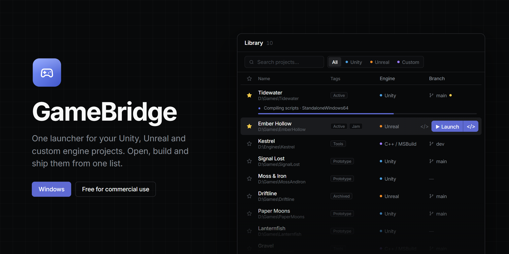

<p align="center">
  
</p>

<p align="center">
  <a href="https://github.com/CookieJarTools/GameBridge/releases/latest"></a>
  
  <a href="LICENSE.md"></a>
</p>

<p align="center">
  <a href="https://github.com/CookieJarTools/GameBridge/releases/latest"><b>Download for Windows</b></a>
  &nbsp;·&nbsp;
  <a href="#getting-started">Getting started</a>
  &nbsp;·&nbsp;
  <a href="#building-from-source">Build from source</a>
</p>

GameBridge keeps all your game projects in one list, whatever engine they use. Unity and Unreal are supported out of the box, and you can add your own engines. From that list you can open a project, open it with your IDE, build it without opening the editor, and upload the result to Steam or itch.io.

## What it does

### One library

Point GameBridge at the folders where your projects live and it finds them. Every project sits in a single table with its engine, version, git branch and tags. You can sort by any column, resize the columns, filter by engine or tag, and search by name or path. Favourites stay at the top.

Click a row to open the project. The launch button on the right also has a second half that opens the project together with the IDE you've set for that engine (VS Code, Rider and Visual Studio are found automatically).

### Your own engines

Unity and Unreal are built in. Anything else can be added in Settings: give it an executable, an argument template and a colour, and optionally a file extension so scans can recognise its projects.

### Builds without the editor

Unity projects build headlessly. Pick a platform, or a Unity 6 Build Profile, and watch the build move through its real phases: switching platform, importing, compiling, building the player. If the project is open in the editor, GameBridge asks before closing it, closes it the polite way so you still get the "save changes?" prompt, and reopens it once the build finishes.

Every build goes into its own numbered folder, like `Builds/StandaloneWindows64/0007_1.2.3`, so nothing is overwritten. A project can bump its own version number before each build.

Other engines build from a command template you set per engine, with optional per-project overrides.

### Build reports and cleanup

After a Unity build you get the output size, time spent per step, and the biggest assets that actually shipped.

The Cleanup tab compares the project folder with that last build and lists files the build didn't use, along with duplicates and orphaned `.meta` files. Nothing is deleted outright. Files go to a quarantine folder next to the project first, so you can test a build without them and restore them if something breaks.

### Publishing

Each project can have upload targets for Steam (steamcmd), itch.io (butler) or any command you like. An upload only happens when you press the button for one build and one target, after a confirmation that names the folder, the version and the destination.

GameBridge never stores a password or API key. steamcmd and butler keep their own logins.

### Logs

Running games and editors stream their output into the Instances view. Logs are coloured by severity, stack traces fold away, and you can filter by level or search with regex. Stopping a log watch leaves the editor running, and Reconnect picks the log up where it left off.

### Game data editor

The Data view opens the JSON files your game reads as a form instead of raw text. True/false values get a switch, numbers get a stepper, and nested objects open like folders. Field names are made readable, with the real key shown underneath. Structural changes like adding or renaming fields are behind an explicit toggle, and every save keeps a backup.

### Unreal and Fab assets into Unity

The Transfer view brings assets from an Unreal project into a Unity project. Point it at the .uproject your Fab packs are added to, tick the folders you want, and pick where they go in Unity.

- **Sounds** come across as WAV files in seconds, with no Unreal needed. Unreal keeps the original WAV inside every sound asset, and GameBridge copies it straight out.
- **Meshes, characters and animations** are exported as FBX by Unreal, which GameBridge runs in the background with no editor window. Characters and their animations import into Unity as Humanoid, so animations retarget onto any humanoid.
- **Textures** come across as PNG, straight out of the asset when it carries one and through Unreal when it doesn't. Normal maps and mask textures are set up correctly from their names.
- **Materials** are rebuilt as Unity materials for whichever render pipeline the project uses (URP, HDRP or built-in) and hooked up to the models. Tick a model and its materials and textures come along with it.

Sound cues, Blueprints and other Unreal-only assets stay behind, and the screen says so. The sounds, textures and animations they use still transfer.

It also takes **Fab downloads**. Many listings offer FBX, GLB or Unity-format files as well; drop the .zip or .unitypackage on the window and it's unpacked into the Unity project. A .unitypackage keeps its original GUIDs, so prefabs and materials still find their textures.

### Asset stores

Fab, the Unity Asset Store, Sketchfab, itch.io, Poly Haven, Kenney and OpenGameArt are built in as tabs, and they stay logged in between sessions.

## Getting started

1. Download **GameBridge-Setup-&lt;version&gt;.exe** from the [latest release](https://github.com/CookieJarTools/GameBridge/releases/latest) and run it. You can pick where it installs, and it adds Start menu and desktop shortcuts. No admin rights needed.
2. Open **Settings** and press **Auto-detect engines** and **Auto-detect IDEs**.
3. Add the folders that contain your projects as **scan roots**.
4. Go back to **Library** and press **Scan**.

Windows only for now. The installer isn't code-signed yet, so SmartScreen will warn you the first time. Choose **More info**, then **Run anyway**.

## Building from source

You need Node.js 18 or newer and Git.

```bash
npm install
npm run dev
```

| Command | What it does |
| --- | --- |
| `npm run dev` | Run with hot reload |
| `npm run build` | Build production bundles into `out/` |
| `npm run typecheck` | Type-check the main process and the renderer |
| `npm run dist` | Build the Windows installer, `dist/<version>/GameBridge-Setup-<version>.exe` |
| `npm run generate:icons` | Rebuild `build/icon.ico` and `icon.png` from `build/icon.svg` |
| `npm run generate:banner` | Rebuild `docs/banner.png` from `scripts/banner/banner.html` |

Built with Electron, React, TypeScript, Vite, Tailwind and Zustand.

## How it works

The sections below go into more detail. You don't need any of this to use the app.

<details>
<summary><b>Launching</b></summary>

<br />

| Engine | How it opens a project |
| --- | --- |
| Unity | Finds `Unity.exe` for the project's version (from Unity Hub's editor list or the editors folder) and runs `Unity.exe -projectPath "<path>"` |
| Unreal | Uses a matching `UnrealEditor.exe` if one is installed, otherwise the Windows file association for `.uproject` |
| Custom | Runs your executable with your argument template, filling in `{exe}`, `{path}`, `{file}` and `{args}` |

IDEs get `{path}`, `{sln}` (the first `.sln` in the project, or the folder if there isn't one) or `{file}`.

</details>

<details>
<summary><b>Headless Unity builds</b></summary>

<br />

Unity can't build from the command line unless the project has an editor method to call. If yours doesn't, GameBridge writes a temporary script to `Assets/GameBridge/Editor/GameBridgeBuilder.cs`, builds with it, and deletes it afterwards. It only removes folders it created, so an existing `Assets/GameBridge` folder is left alone. The same script saves Unity's `BuildReport` as JSON, which is where the report tab gets its numbers.

```
Unity.exe -batchmode -projectPath <path> -buildTarget <target>
          -executeMethod GameBridgeGenerated.GameBridgeBuilder.BuildFromArgs -logFile -
          -gbTarget <BuildTarget> -gbOutput <artifact> -gbReport <json> [-gbDevelopment]
```

**Build profiles.** Unity 6 Build Profiles are found by reading the `.asset` files under `Assets`, so no editor needs to be running to list them. Picking one passes `-gbProfile <asset path>`, and the script builds with `BuildPlayerWithProfileOptions`. The profile then decides the platform, scenes and player settings. That code is behind `#if UNITY_6000_0_OR_NEWER`, so the script still compiles on older editors.

**Progress.** Unity's batchmode log doesn't report a percentage. GameBridge reads the log for the phase Unity is in and turns that into a weighted estimate, and the activity line shows the last thing the log said.

**Stopping** kills the Unity process tree and removes the temporary script.

</details>

<details>
<summary><b>Closing an open editor before a build</b></summary>

<br />

Unity won't build a project that's open in another editor. Before building, GameBridge checks `Library/EditorInstance.json`, plus any editor it launched itself, for a live process holding the project. What happens next depends on the setting: ask (the default), always close, or never close.

It closes the editor with `CloseMainWindow()`, the same message Windows sends when you click the X, so Unity can still ask about unsaved changes. Plain `taskkill` without `/F` turned out to be unreliable here. In testing, Unity ignored it for over a minute, while `CloseMainWindow()` closed it in about a second. If the editor is still open after 30 seconds, you're asked whether to force it closed or cancel the build.

When the build ends, whatever the result, the project is reopened the normal way.

</details>

<details>
<summary><b>Build folders and version bumping</b></summary>

<br />

Builds go to `Builds/<target or profile>/<NNNN>_<version>/`. The counter carries on from whatever's already on disk, so deleting folders by hand never causes a clash. Typing your own output path in the build dialog overrides this. A per-project "builds to keep" setting can prune old folders, but it's off by default because they're your files.

Version bumping runs before the build, so the folder is named after the version the build actually contains. You can bump the last number, the minor or the major. Only the leading numbers change, so `1.2.3-beta` keeps its suffix. The Android version code and the per-platform build numbers go up as well.

The edit to `ProjectSettings.asset` is deliberately narrow. It refuses to run unless there's exactly one `bundleVersion` line, and it only touches that line, `AndroidBundleVersionCode` and the entries under `buildNumber:`. An early version of the pattern ran past the end of the `buildNumber:` block and bumped unrelated settings like `AndroidMinSdkVersion`, so the test now checks the exact list of fields that changed.

</details>

<details>
<summary><b>Publishing</b></summary>

<br />

| Target | You provide | GameBridge runs |
| --- | --- | --- |
| Steam | steamcmd path, App ID, Depot ID, username, optional branch | `steamcmd +login <user> +run_app_build <generated .vdf> +quit` |
| itch.io | butler path, `user/game:channel` | `butler push <folder> <target> --userversion <version>` |
| Custom | any command | your command, with `{output}`, `{outputDir}`, `{version}`, `{name}`, `{target}` and `{profile}` filled in |

The Steam `.vdf` is generated fresh for each upload, so there's nothing to maintain by hand. A dry-run target uses Steam's preview mode or butler's `--dry-run`.

To log in, run `steamcmd +login <user>` or `butler login` once in a terminal. Both tools cache the login themselves. If their output mentions Steam Guard, a rejected login or a missing butler key, GameBridge adds a plain explanation to the log.

Tools that ship as `.cmd` or `.bat` files are started through `cmd.exe`, because Node won't spawn them directly on Windows.

</details>

<details>
<summary><b>Transferring from Unreal</b></summary>

<br />

GameBridge reads each `.uasset` header itself (the package summary, name table and import table) to tell what an asset is, so listing a project takes well under a second and needs no engine. It has been checked against packages saved by UE 5.1 through 5.8. Packages from UE 4 should read too but haven't been tested.

| Asset | Becomes | How |
| --- | --- | --- |
| Sound wave | `.wav` | Copied out of the `.uasset`, which keeps the original WAV byte for byte. Falls back to Unreal if it doesn't carry one |
| Texture | `.png` | Copied out when the asset carries a PNG, otherwise exported by Unreal |
| Static mesh | `.fbx` | Exported by Unreal |
| Skeletal mesh | `.fbx` | Exported by Unreal, imported into Unity as Humanoid |
| Animation sequence | `.fbx` | Exported by Unreal, imported into Unity as a Humanoid clip |
| Material | `.mat` | Described by Unreal, rebuilt by Unity (see below) |

Unreal is run as `UnrealEditor-Cmd.exe <project> -run=pythonscript -script=<export script>`, with the Python plugin switched on for that run only, so the `.uproject` isn't modified. It needs the engine version the project was made with to be installed; GameBridge finds engines through the Epic launcher's install list, so engines in custom folders are found too. If Unreal crashes on an asset, that asset is reported as failed and Unreal is started again for the rest.

Import settings are written as `.meta` files before each asset lands, so Unity imports it correctly the first time. These were checked by importing the UE 5.8 mannequin into Unity 6000.4:

- Scale needs no setting: Unity reads Unreal's centimetres from the FBX, and Manny comes in 1.81 m tall.
- Axis conversion is left off on purpose. Baking it turns Unreal characters round to face away from the camera.
- Each animation gets its own Humanoid avatar. Copying the character's avatar doesn't work, because Unreal names each FBX's root after the file.
- Textures ending in `_N`, `_BN` or `_Normal` import as normal maps, and packed masks (`_ORM`, `_ARM`, `_MSK` and similar) import as linear data.

A `.meta` that already exists is never changed, so replacing a file keeps every reference to it working.

</details>

<details>
<summary><b>Rebuilding materials</b></summary>

<br />

An Unreal material is a node graph, and there's no general way to turn one into a Unity shader. What carries across is what a Lit material needs: which texture is the colour, which is the normal map, where metallic, roughness and ambient occlusion live, a tint, and whether the material is opaque, masked or translucent.

**Finding the parts.** Unreal is asked for each material's texture parameters, values, blend mode and two-sidedness. Parameter names are whatever the pack's author chose ("Base Texture", "BNormal", "MRA"), so GameBridge reads the role from the parameter name first and the texture's suffix (`_D`, `_N`, `_ORM`) second. Packed maps come in several layouts, so the channel order is read from the letters: `ORM` is AO, roughness and metallic in R, G and B, while `MRA` is metallic, roughness and AO.

**Which assets come along.** Without starting Unreal, GameBridge reads which materials each model uses and which textures each material uses from the package headers. A material instance only lists the textures it overrides, so its parent materials are followed for the rest.

**Building them.** GameBridge writes a manifest and a small editor script into `Assets/GameBridge/Editor/Materials`. The script runs the next time Unity compiles, whether the editor was already open or opens later. It:

- creates a material per Unreal material, next to where the Unreal one was, using URP Lit, HDRP Lit or Standard as the project calls for,
- repacks metallic, roughness and AO into the one mask texture Unity reads (metallic in R, AO in G, smoothness in A),
- points each model's material slots at the new materials,
- then deletes itself, along with any folders it leaves empty.

It uses Unity's own material APIs rather than writing `.mat` files, because a material only uses a texture once its shader keywords are set, and Unity sets those properly.

This was checked by transferring the UE 5.8 mannequins into fresh built-in, URP and HDRP projects and rendering the built-in and URP results. Detail that only exists in the Unreal graph, such as decals, procedural masks or panning, doesn't come across.

</details>

<details>
<summary><b>Cleanup rules</b></summary>

<br />

The main signal is "the last successful build didn't include this file". The injected build script records every packed asset and every scene that was built, and Cleanup compares that list with what's on disk. It also flags things that don't need a build to spot: byte-identical duplicates, orphaned `.meta` files and layered source art.

None of that is proof, so suggestions are graded:

- **Never suggested:** scripts, native plugins, anything in an `Editor` or `StreamingAssets` folder, and GameBridge's own folder.
- **Likely safe:** media the build skipped.
- **Check first:** scenes and less common file types.
- **Risky:** shaders, data files, and anything in a project that uses Addressables. Bundles, `Resources` lookups and dynamic loading don't show up in a build report, and such projects get a warning banner.

A duplicate that shipped is never suggested, because removing it would break a reference. Only the unused copies are listed.

Quarantine moves files to `<project>_GameBridgeRemoved` next to the project, keeping the folder structure and taking each `.meta` file along. From there you can restore them exactly where they were, or send them to the Recycle Bin. Every action shows the file count and total size first, and anything outside the project's `Assets` folder is refused. Files you mark as needed are stored per project and skipped by future scans.

</details>

<details>
<summary><b>Asset analysis</b></summary>

<br />

The Project assets tab scans the folder directly, with no engine or build involved. It looks at the engine's source folders (`Assets` and `Packages` for Unity, `Content` and `Source` for Unreal, everything for custom engines), measures generated folders like `Library` and `Temp` separately, and reports:

- totals by category and the largest files
- textures with compression off or a 4096+ max size, read from their `.meta` files
- large audio left as PCM or set to decompress on load
- assets missing a `.meta` file, and layered PSD or TIFF files under `Assets`
- byte-identical duplicates and how much space they waste

</details>

<details>
<summary><b>Saving game data safely</b></summary>

<br />

The Data view lists every JSON file in a project, skipping folders like `Library`, `Temp` and `node_modules`. You can also open any JSON file from elsewhere.

Before writing, the new text is parsed to make sure it's valid. The previous version is copied to `json-backups/` in the app's data folder (the last ten per file, kept outside the project so the engine doesn't import them). The file is then written to a temp file and renamed into place, so a crash halfway through can't leave it half-written. Indentation and any byte-order mark are kept as they were.

Files that don't parse open as text with the parser's error, so you can fix them. Files over 5 MB also open as text. If a file uses number-like keys, you'll see a warning, because JavaScript reorders those keys and saving would change their order.

</details>

<details>
<summary><b>Where data is stored</b></summary>

<br />

Everything lives in `%APPDATA%/gamebridge/`:

| File | Contents |
| --- | --- |
| `gamebridge-data.json` | projects, engines, settings |
| `gamebridge-builds.json` | build history |
| `build-reports/` | saved Unity build reports |
| `gamebridge-quarantine.json` | what's in quarantine and where it came from |
| `json-backups/` | previous versions of edited data files |

Column widths in the library are remembered per machine.

</details>

## Project layout

```
src/
  shared/        types shared by the main process and the UI
  main/          Electron main process
    scanner.ts     finding projects on disk
    detect.ts      finding engines and IDEs
    launch.ts      opening projects and IDEs
    build.ts       running builds, history, cancelling
    unitybuild.ts  the injected Unity build script and log parsing
    editorlock.ts  detecting and closing an editor that holds a project
    version.ts     reading and bumping project versions
    publish.ts     Steam, itch.io and custom uploads
    cleanup.ts     cleanup suggestions and quarantine
    assetscan.ts   static asset analysis
    jsonfiles.ts   listing, reading and safely writing JSON
    transfer.ts    Unreal and Fab assets into Unity
    uasset.ts      reading Unreal package headers without the engine
    unrealexport.py  the export script Unreal runs in the background
    unitymeta.ts   Unity import settings written ahead of each asset
    materialspec.ts  working out what each texture in an Unreal material is for
    unitymaterials/  the editor script that rebuilds materials inside Unity
    run.ts         game output and editor log tailing
    store.ts       saving app data
  preload/       the bridge between the main process and the UI
  renderer/      the React UI
```

## Design

The UI borrows from Linear: near-black surfaces, thin borders instead of shadows, four levels of text colour, a 13px base size and one accent colour (`#5E6AD2`) used only for selection, focus and primary actions. Engine colours are the one exception.

Colours, type sizes and radii are defined in the `@theme` block at the top of [`src/renderer/src/index.css`](src/renderer/src/index.css), along with the shared component classes (`btn-*`, `input`, `panel`, `row`, `chip` and so on). New UI should use those classes instead of one-off styles.

## Ideas for later

- Search itch.io, Poly Haven and Sketchfab through their APIs instead of embedding their websites
- Project thumbnails taken from Unity and Unreal's saved previews
- Installing a missing Unity version through Unity Hub when a project needs it
- Per-project launch arguments and environment variables
- Headless Unreal builds through UAT `BuildCookRun`
- A build queue for building several projects in a row
- Clickable file paths in logs that open in your IDE

## Licence

GameBridge is released under the [PolyForm Shield License 1.0.0](LICENSE.md). You can use it for anything, including making and selling games with it. The one thing you can't do is use it to build a product that competes with GameBridge itself.
